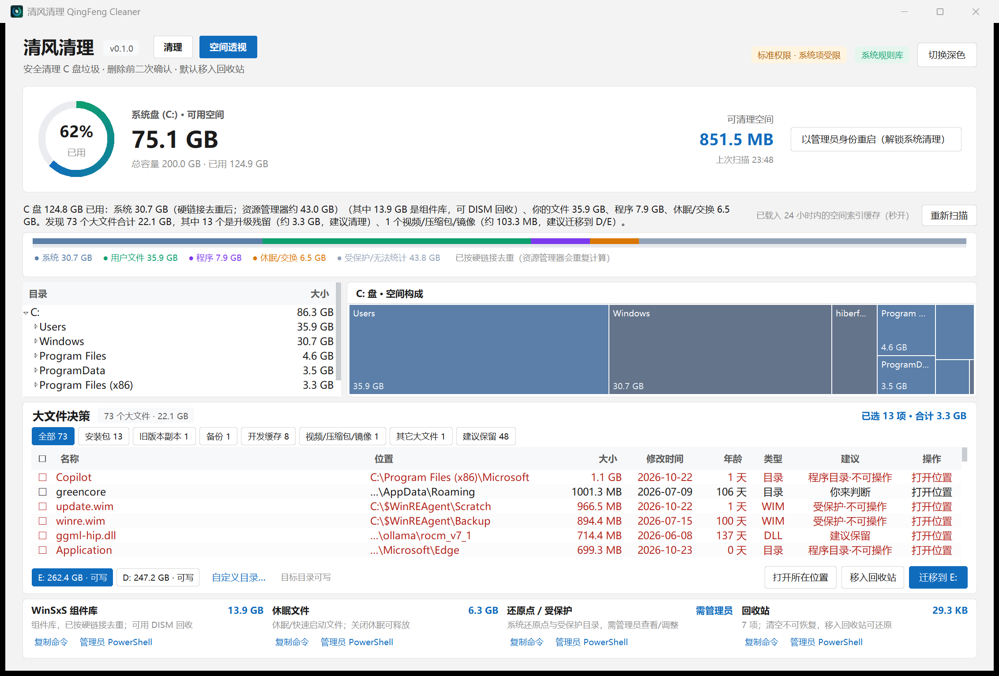
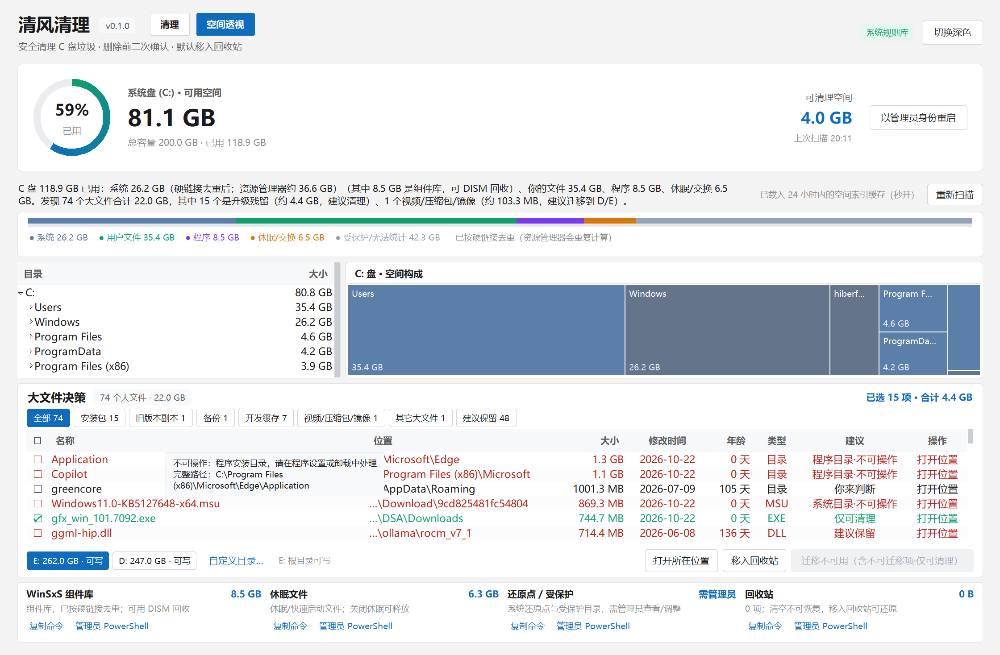
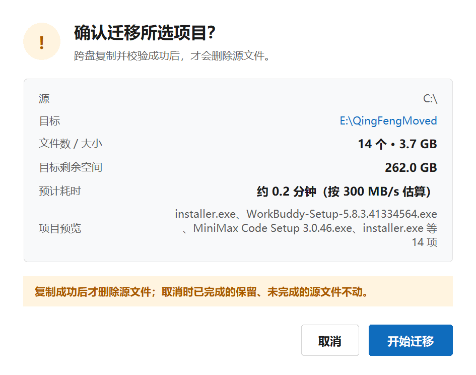
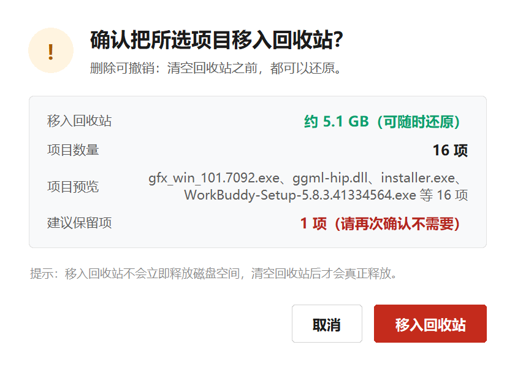
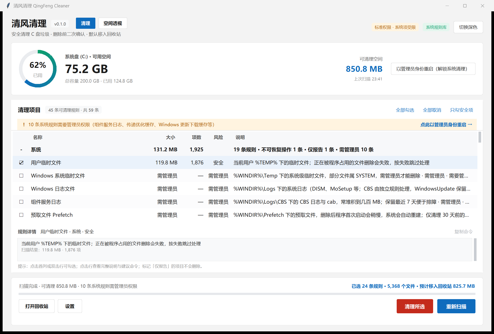
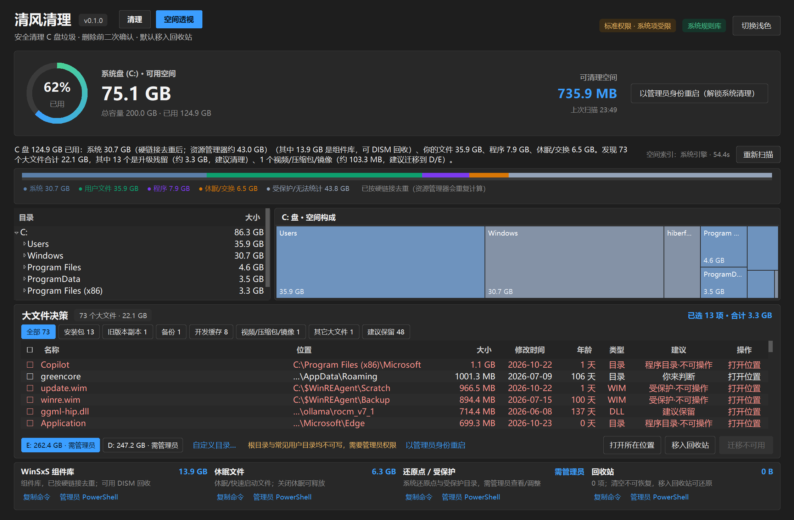

# 清风清理 · QingFeng Cleaner

> **一个开源、可审计、零第三方依赖的 Windows 11 C 盘工具：清理已知缓存 + 空间透视 + 大文件决策 + 迁移到 D/E 盘。默认只扫描不删除，删除走回收站。**

<!-- GitHub 仓库：https://github.com/lubairong/qingfeng-cleaner -->
[](https://github.com/lubairong/qingfeng-cleaner/actions/workflows/ci.yml)
[](https://www.python.org/downloads/)
[](LICENSE)
[](#)
[](#)

**清风清理（QingFeng Cleaner）** 是一个纯 Python 3.12 标准库（tkinter + ctypes）实现的 C 盘工具：
带 Windows 11 风格图形界面 + 系统托盘，**零第三方依赖**，不联网、无遥测、不写注册表。
v2 起有两个页面：**「清理」**按规则清已知缓存；**「空间透视」**把 C 盘构成画成构成条与 Treemap，
列出大文件并给分类建议，支持一键移入回收站或**迁移到 D/E 盘**。
设计目标只有一个：**让你敢点那个「清理」按钮，也知道那 100 多 GB 到底在哪。**

---

## English Summary

**QingFeng Cleaner** is an open-source C: drive tool for Windows 11, written in pure Python 3.12
standard library (tkinter + ctypes) with **zero third-party dependencies**, a Windows 11–style GUI and a
system tray icon. Since v2 it has two pages: **Clean** (rule-based cache cleanup) and **Space Inspector**
(usage breakdown bar, directory tree + squarified Treemap drill-down, big-file decision groups, one-click
recycle and **move to D:/E:** with copy-then-delete semantics). It is **scan-first and safe by design**:
nothing is deleted unless you explicitly select items and confirm; deletions go to the **Recycle Bin by
default**; a hard-coded protected-path guard (`safety.py`) plus an action-authorization matrix refuse to
touch system/program directories; advanced/privacy rules are disabled by default; system-level commands
(DISM/powercfg/vssadmin) are only shown for copying, never executed by the app. No telemetry, no network
code, no registry writes. MIT licensed. See [docs/usage.md](docs/usage.md) for the CLI and
[docs/faq.md](docs/faq.md) for safety details.

---

## 目录

- [截图](#截图)
- [特性](#特性)
- [空间透视与决策助手（v2）](#空间透视与决策助手v2)
- [安全声明](#安全声明)
- [安装与运行](#安装与运行)
- [管理员模式（提权）](#管理员模式提权)
- [命令行参数](#命令行参数)
- [目录结构](#目录结构)
- [清理规则格式](#清理规则格式)
- [常见问题](#常见问题)
- [参与贡献](#参与贡献)
- [开源致谢](#开源致谢)
- [免责声明](#免责声明)
- [许可证](#许可证)

---

## 截图

**空间透视页（v2 主打）**：磁盘构成条（系统 / 用户 / 程序 / 休眠交换 / 受保护）、左侧目录树 + 右侧 Treemap
（点击下钻、面包屑返回）、大文件决策表与「移入回收站 / 迁移到目标」动作、系统占用卡片。
本机真实数据：C 盘 118.2 GB 已用，74 个大文件合计 22.0 GB，E:/D: 显示可写：



大文件决策区特写：按「安装包 / 升级残留」「程序的旧版本副本」「视频 / 镜像」「建议保留」等分组，
受保护项显示「受保护·不可操作」并在悬停时说明原因（如「程序安装目录，请在程序设置或卸载中处理」）：



迁移二次确认框：显示目标盘 `E:\QingFengMoved` 与可用空间，并明确「复制成功后才删除源文件」：



回收站二次确认框（清理页 / 空间页共用）：显示项目数、预计释放空间与「可随时还原」提示：



**清理页（v1，v2 起保留为双页之一）**：按分类分组的缓存清理，勾选 + 二次确认 + 回收站：



**深色模式**（右上角「切换深色 / 切换浅色」，两页同步）：



**系统托盘**：在普通用户权限下可用，右键菜单含「显示主窗口 / 快速扫描 / 退出」；关闭主窗口默认最小化到托盘
（可在设置里关闭该行为）。托盘区显示下方图标（图标资源由 `assets/app.ico` 生成，**非托盘实机截图**）：


> 截图由**完整权限会话**在真实数据上拍摄（175% DPI、C/D/E 实盘），位于 `docs/images/`；
> 所有确认框截图时均已取消，**未执行任何清理或迁移**。

---

## 特性

- **默认只扫描，不删除** — 进来先看报告；删除必须手动勾选 + 二次确认。
- **删除默认走回收站** — `SHFileOperationW` + `FOF_ALLOWUNDO`，删错可还原；永久删除需单独开关。
- **保护路径硬编码守卫** — `C:\Windows`、`C:\Program Files`、用户主目录、`System Volume Information` 等
  一律拒绝删除，规则无法覆盖；`within_root()` 防路径穿越。
- **规则覆盖面** — 内置 **59 条**清理规则，分 6 大类（系统 19 / 应用 14 / 浏览器 6 / 隐私痕迹 7 / 大文件 5 / 系统维护 8）。
- **风险分级** — 每条规则标注 `safe` / `caution` / `advanced`，高级规则默认关闭。
- **分类清晰** — 系统 / 浏览器 / 应用 / 隐私痕迹 / 大文件 / 系统维护，按分类分组展示。
- **空间透视（v2）** — 把「已用 122.8 GB」拆成 系统 / 用户 / 程序 / 休眠交换 / 受保护等构成条；
  目录树 + 自绘 Squarified **Treemap** 双视图，点击色块下钻、双击打开、面包屑返回；写明「受保护/无法统计」
  的那部分到底包含什么（还原点、回收站、无权限目录），不假装它们不存在。
- **大文件决策助手（v2）** — 对索引里 ≥100 MB 的大文件按 `qingfeng/data/heuristics.json`（14 分类 +
  `never_touch` 规则 + 年龄阈值）自动分组，逐项给出「放心清理 / 可清理 / 建议迁移 / 建议保留」和一句话理由。
- **一键回收站 / 迁移到 D/E（v2）** — 选中的大文件可移入回收站，或迁移到其它固定磁盘；迁移保留
  `<目标盘>\C_mirror\<原相对路径>` 结构、**复制成功后才删除源文件**、失败保留源、可随时取消；
  「受保护·不可操作」项的动作按钮直接禁用并显示原因。
- **系统占用只给命令（v2）** — WinSxS / 休眠 / 页面文件 / 还原点 / 回收站等卡片只展示大小与建议命令，
  「复制命令」「以管理员身份打开 PowerShell」只做复制/开窗，**工具绝不代执行 DISM / powercfg / vssadmin**。
- **索引缓存、只读、不联网（v2）** — 索引按 inode 去重、跳过 reparse point、只读扫描；结果缓存 24 小时
  （`%LOCALAPPDATA%\QingFengCleaner\space_index.json`，二次打开秒开），不上传、不写注册表。
- **Windows 11 风格界面** — 标准系统标题栏（随主题深/浅色联动），窗口内为自绘圆角卡片、圆角按钮与自绘磁盘占用环，
  ttk 配色 + 高 DPI 适配。
- **系统托盘** — 关闭窗口最小化到托盘，托盘菜单支持快速扫描。
- **扫描线程安全** — 后台线程扫描 + `queue.Queue` 回传，界面不假死，可随时取消。
- **零第三方依赖** — 只要 Python 3.12 标准库；`pip install` 一行都不用跑。
- **测试与验证** — **176 个**标准库 unittest（v1 118 + v2 58，含 2 个按平台跳过）全绿；`tools/verify.ps1`
  一键端到端验证（单元测试 → 只扫描 → GUI 存活 → 空间索引 → 决策冒烟 → 维护者审计 → 打包归档 →
  目录版产物 → 单文件 exe），逐项打印 PASS/FAIL/SKIP。
- **两种打包形态** — `packaging/build.ps1` 用 PyInstaller 产出**目录版**（`dist/QingFengCleaner-onedir/`，
  唯一推荐、已验证可运行）和启动器 `dist/启动清风清理.bat`（双击即用、支持传参）；**单文件版已不作为交付物**
  （中文路径下自解压不可靠），仅保留 `-OneFile` 实验开关输出到 `dist/_experimental/`。

### 清理范围（规则集）

| 分类 | 典型内容 |
|---|---|
| 系统 | 用户/系统临时文件、Windows 更新缓存、日志、内存转储、缩略图缓存、字体缓存、错误报告 |
| 浏览器 | Edge / Chrome / Firefox / Opera 缓存、GPU 缓存、崩溃报告（**不动密码/书签/Cookie**） |
| 应用 | 微信（**默认关闭**）、钉钉、Office、Teams、OneDrive、Steam、Discord、Zoom、VS Code、Adobe、Java WebStart、npm / pip 等应用与开发工具缓存 |
| 隐私痕迹 | 最近文件记录、跳转列表、剪贴板历史、通知中心、浏览记录（advanced，默认关闭） |
| 大文件 | C 盘 top N 大文件/大目录、下载目录大文件、残留安装包（**只报告，不删除**） |
| 系统维护 | 休眠文件、WinSxS、还原点、页面文件、Windows Installer 缓存、保留存储（报告建议命令或需管理员） |

> 具体规则见 [`qingfeng/data/rules/`](qingfeng/data/rules/)，每条规则标了 `source` 参考来源。
> 规则集参考 **winapp2.ini / BleachBit / Microsoft Learn** 等开源项目与官方文档整理（代码为自研），
> 调研与红队复审记录见 [`docs/research/integration-map.md`](docs/research/integration-map.md) 与
> [`docs/research/redteam-review.md`](docs/research/redteam-review.md)。

---

## 空间透视与决策助手（v2）

v1 只能清已知缓存路径（本机约 0.7 GB），但 C 盘一百多 GB 里的大头并不在那里。v2 新增一个**只读**的空间透视页：

- **磁盘构成条**：把「已用」拆成 系统 / 用户 / 程序 / 休眠与交换 / 受保护（还原点、回收站、无权限目录），
  每段标 GB 与占比 —— 受保护的那部分会**显式展示**，不假装不存在。
- **目录树 + Treemap 下钻**：左侧树按大小降序可展开；右侧自绘 Squarified Treemap 用面积表示大小、
  颜色按类型区分，**点击下钻、双击在资源管理器打开、面包屑返回上级**。
- **大文件决策表**：对索引中 ≥100 MB 的文件（默认最多 800 项）按 `qingfeng/data/heuristics.json`
  （14 分类 + `never_touch` 规则 + 年龄阈值）自动分组，逐项给建议与一句话理由：

  | 分组 | 默认建议 |
  |---|---|
  | 安装包 / 升级残留 | 放心清理（回收站） |
  | 程序的旧版本副本 | 可清理（先确认程序未在用旧版） |
  | 备份 / 旧副本 | 可清理（确认无回滚需求） |
  | 开发缓存 / 构建产物 | 可清理（下次构建会重建） |
  | 视频 / 压缩包 / 镜像 | 建议迁移到 D/E |
  | 其它大文件 | 你来判断 |
  | 建议保留（模型 / 数据 / 数据库） | 不要删 |

- **动作**：勾选后「移入回收站」（可还原；空间页**没有永久删除**）或「迁移到目标」（先选 D:/E: 目标目录，
  二次确认后执行）。迁移保留 `<目标盘>\C_mirror\<原相对路径>` 结构，**复制成功后才删源文件**。
- **索引**：只读扫描、按 inode 去重（硬链接不重复计数）、跳过 reparse point；冷启动目标 ≤60 秒且有进度条/可取消，
  24 小时内再次打开走缓存**秒开**。

v2 动作授权矩阵（与引擎 `decide.action_policy()` 一致，界面按钮状态直接读它）：

| 区域 | 移入回收站 | 迁移 |
|---|---|---|
| `C:\Users\<你>\**`（含 AppData，`Packages` 除外） | ✅ | ✅ |
| `C:\ProgramData\**` | ⚠️ 仅安装包类（如 Intel DSA 的 Downloads） | ❌ |
| `C:\Windows\**`、`C:\Program Files( (x86))\**` | ❌ 只展示 | ❌ |
| `$Recycle.Bin`、`System Volume Information`、`Recovery`、`EFI`、`Boot` | ❌ | ❌ |

> 受保护项显示「受保护·不可操作」，按钮禁用并给出原因；「建议保留」组默认不勾选。
> 系统级维护命令（DISM / powercfg / vssadmin）只提供文本与「复制命令」，工具不会代替你执行。

---

## 安全声明

本项目把「不误删」当作第一优先级，四条底线：

1. **只扫描是默认行为。** 启动后第一屏永远只是扫描结果，不自动清理任何文件。
2. **保护路径不可覆盖。** `C:\`、`C:\Windows`、`C:\Program Files`、`C:\Users\<user>`、
   `C:\Windows\System32`、`C:\System Volume Information` 等目录及其关键子目录，删除请求会被
   `safety.py` 直接拒绝并抛 `UnsafePathError`。规则作者也无法绕过。
3. **默认回收站。** 删除走 `FOF_ALLOWUNDO`，可从回收站还原；「永久删除」是独立开关，默认关闭。
4. **危险操作只给建议，不硬删。** 清空回收站、休眠文件、Windows 更新缓存等，要么需管理员确认，
   要么以 `action: "report"` 形式给出建议命令，由你决定是否执行。
5. **空间透视页只提供「移入回收站」。** 该页没有永久删除开关；受保护/系统/程序目录一律不可操作，
   `decide.action_policy()` 拒绝的项目按钮直接禁用。
6. **迁移是「复制成功才删源」。** 只能迁到其它固定磁盘，保留目标盘镜像目录；复制失败或中途取消时
   **源文件不动**，不会出现两边都没有的半截状态。

   > 迁移确认框会写明目标盘、目标根目录，以及「复制成功后才删除源文件」：
   > 
7. **系统级命令只给不代执行。** DISM / powercfg / vssadmin 等只展示 + 复制，工具不会替你运行任何提权命令。
8. **索引只读、不上传。** 空间索引按 inode 去重、不跟随 reparse point、不修改被扫目录；结果只缓存在
   `%LOCALAPPDATA%\QingFengCleaner\space_index.json`（24 小时），不写注册表、不联网。

另外：**不联网、不上传任何数据、无遥测、不写注册表、不装服务/驱动。** 不放心可以断网运行，
或只用只扫描模式：

```bat
python main.py --scan-only
```

> 需要管理员权限才能清理的系统级项目（Windows 临时文件、更新缓存、CBS/系统日志、系统错误报告等），
> 见 [管理员模式（提权）](#管理员模式提权)。不需要提权也能安全清理用户级缓存。

发现安全问题请**不要**公开提 Issue 披露细节，直接私下联系维护者。

---

## 安装与运行

### 方式 A：下载打包版（普通用户）—— 唯一推荐：目录版 + 启动 bat

1. 从 Releases 下载 `QingFengCleaner-onedir.zip`，解压到任意目录（例如 `D:\Tools\QingFengCleaner\`）。
2. 解压后应看到：`启动清风清理.bat` 与 `QingFengCleaner-onedir\`（内含 `QingFengCleaner.exe` 和 `_internal\`）。
   **整个目录一起用，不要只单独拷走 exe。**
3. **双击 `启动清风清理.bat` 运行**（它转调目录版 exe 并透传参数，适合直接双击/发快捷方式）；
   也可以直接双击 `QingFengCleaner-onedir\QingFengCleaner.exe`。
4. SmartScreen 提示「未知发布者」是未签名 exe 的正常现象（「更多信息 → 仍要运行」）。

> **为什么没有单文件版？** PyInstaller 单文件 exe 每次启动都要先把自身解压到临时目录；实测在**中文路径**下
> 会弹出 `Could not create temporary directory!` 并挂起。目录版不需要运行时自解压，已在真实用户令牌 +
> 中文路径下验证可运行，因此**只交付目录版**。想自己实验单文件版可运行
> `packaging\build.ps1 -OneFile`，产物在 `dist\_experimental\`，不随发布提供。

### 方式 B：源码运行（开发者 / 想审计代码的人）

需要 **Python 3.12**（官方安装包自带 tkinter）。本项目零第三方依赖。

```bat
:: 克隆或解压后，进入项目根目录
packaging\run_dev.bat

:: 或
python main.py
```

打包（可选，需要网络把 PyInstaller 装进项目内 `.venv`；**默认只产出目录版交付结构**）：

```powershell
powershell -ExecutionPolicy Bypass -File packaging\build.ps1
# 产物：dist\QingFengCleaner-onedir\QingFengCleaner.exe（唯一交付形态）
#       dist\启动清风清理.bat（双击即用的启动器）

# 可选：额外构建单文件实验版（不属于交付物）
powershell -ExecutionPolicy Bypass -File packaging\build.ps1 -OneFile
#       dist\_experimental\QingFengCleaner.exe
```

> 打包入口是 `packaging/launcher.py`：它在调用 `main.main()` 前修复无控制台 exe 的
> `sys.stdout/sys.stderr`，保证 `QingFengCleaner.exe --scan-only` / `--version` / `--page space` 都能正常用。
> 产物内已包含 `qingfeng/data/`（规则库 + v2 分类词典 `heuristics.json`）与 `assets/app.ico`。
> 若 pip 装不上（网络/权限受限），脚本会明确报错；此时直接用 `packaging\run_dev.bat` 运行源码即可，
> 功能完全一致。

### 方式 C：只扫描 / 直接打开空间透视

```bat
:: 只扫描缓存（v1 行为，不删除任何文件、不启动界面）
python main.py --scan-only

:: 直接启动到「空间透视」页（v2）
python main.py --page space
```

---

## 管理员模式（提权）

清风清理**不提权也能用**：普通用户下可以扫描并清理你自己的缓存（`%TEMP%`、浏览器/应用缓存、回收站等），
也能用空间透视页看构成、做迁移。只有下面这些**系统级项目**才需要管理员：

| 需要管理员 | 原因 |
|---|---|
| Windows 系统临时文件（`C:\Windows\Temp`）、Prefetch | 系统目录，普通用户无写权限 |
| Windows 更新下载缓存、传递优化缓存 | 属于系统服务目录 |
| CBS / 系统日志（`C:\Windows\Logs`）、系统错误报告（WER 全机） | 系统目录与 ProgramData |
| 清空回收站（含其他用户的回收站项） | `C:\$Recycle.Bin` 下的其他 SID 目录 |
| WinSxS 组件清理（DISM）、休眠文件（powercfg）、还原点（vssadmin） | 系统维护命令，**工具只给命令、不代执行** |

两种提权方式：

1. **界面内一键提权**：非管理员时点右上角「以管理员身份重启」。修复后的 `restart_as_admin` 会在 frozen
   打包版里正确地以管理员身份重新启动**同一个程序**，并保留当前页面（清理页 / 空间透视页）。
2. **手动**：右键 `QingFengCleaner-onedir\QingFengCleaner.exe`（或 `启动清风清理.bat`）→「以管理员身份运行」。

不提权时，需要管理员的规则会显示「需要管理员权限」（而不是「扫描出错」）并跳过，你仍可完成用户级清理；
空间透视页的索引、大文件决策、迁移到可写 D/E 盘也不需要管理员。

---

## 命令行参数

| 参数 | 说明 |
|---|---|
| *(无参数)* | 启动图形界面，含系统托盘，默认显示「清理」页 |
| `--page clean\|space` | 启动时显示页面：`clean`=清理页（默认），`space`=空间透视页（v2） |
| `--scan-only` | 只扫描并打印报告，不启动界面、不删除任何文件（v1 行为保留） |
| `--no-tray` | 不启用系统托盘 |
| `--hidden` | 启动时直接隐藏到托盘 |
| `--rules-dir <路径>` | 使用自定义规则目录替代 `qingfeng/data/rules/` |
| `--version` | 打印版本号并退出 |
| `-h`, `--help` | 帮助 |

完整用法、输出示例、退出码见 **[docs/usage.md](docs/usage.md)**。

---

## 目录结构

```
qingfeng-cleaner/
├─ main.py                     # 程序入口 + 命令行参数
├─ qingfeng/
│  ├─ __init__.py              # APP_NAME / __version__ / 路径常量
│  ├─ core/                    # 引擎（不依赖 tkinter）
│  │  ├─ models.py             # dataclass 数据模型
│  │  ├─ rules.py              # 规则加载与校验
│  │  ├─ safety.py             # 路径安全守卫（保护名单）
│  │  ├─ winapi.py             # ctypes Win32 封装（回收站 / 磁盘 / 管理员）
│  │  ├─ scanner.py            # 扫描
│  │  ├─ cleaner.py            # 清理
│  │  ├─ space.py              # v2：磁盘索引（树）+ 系统占用探测 + 缓存
│  │  └─ decide.py             # v2：大文件分类/建议、授权矩阵、回收站与迁移
│  ├─ data/
│  │  ├─ rules/*.json          # 规则集（59 条 / 6 分类，一个分类一个文件）
│  │  └─ heuristics.json       # v2：大文件分类词典（扩展名/路径/年龄/never_touch）
│  └─ ui/                      # tkinter 界面
│     ├─ theme.py              # 配色 / 样式 / 高 DPI
│     ├─ main_window.py        # 主窗口 + 两页导航
│     ├─ widgets.py            # 自绘组件
│     ├─ dialogs.py            # 二次确认等对话框
│     ├─ engine.py             # 引擎适配层（含降级逻辑）
│     ├─ mock_engine.py        # 界面独立开发用的演示数据
│     ├─ tray.py               # 系统托盘（Shell_NotifyIconW）
│     ├─ space_page.py         # v2：空间透视页（构成条 / 决策表 / 迁移）
│     ├─ treemap.py            # v2：自绘 Squarified Treemap 画布
│     └─ actions.py            # v2：打开位置 / 回收站 / 迁移 / 管理员 PowerShell
├─ assets/                     # app.ico / app_256.png / 图标生成脚本
├─ tests/                      # 176 个单元测试（标准库 unittest）
├─ tools/
│  ├─ verify.ps1               # 一键端到端验证（含 v2 空间索引/决策/审计步骤）
│  ├─ capture_screenshots.py   # 真实界面截图（生成 docs/images/）
│  ├─ check_links.py           # 文档相对链接检查
│  └─ sandbox_exec.py / pip_sandbox.py  # 受限沙箱下的打包辅助（普通环境不需要）
├─ packaging/
│  ├─ run_dev.bat              # 开发启动（用内置 Python 直接跑 main.py）
│  ├─ build.ps1                # PyInstaller 打包（默认只出目录版 + 启动 bat；-OneFile 实验）
│  └─ launcher.py              # 打包入口（修复无控制台 stdio 后转交 main）
├─ docs/
│  ├─ ARCHITECTURE.md          # v1 接口契约（改动需先讨论）
│  ├─ ARCHITECTURE-V2.md       # v2 增量契约（空间透视 + 决策助手）
│  ├─ usage.md                 # 使用手册
│  ├─ faq.md                   # 常见问题
│  ├─ research/                # 调研 / 落地映射 / 红队复审 / 空间分析笔记
│  └─ images/                  # README 用的真实截图
├─ qa/                         # 维护者用：独立安全审计（lead_audit.py 在 CI 跑，v2 审计在开发机跑）
│  ├─ lead_audit.py            # v1 规则/安全边界审计
│  ├─ lead_audit_v2.py         # v2 空间索引/决策/授权/回收站/迁移审计（需完整权限会话）
│  └─ smoke_clean.py           # 受控目录上的清理冒烟测试
├─ .github/workflows/ci.yml    # CI：unittest + 扫描冒烟 + v2 冒烟 + 死链 + 可选打包
├─ README.md  LICENSE  .gitignore  CONTRIBUTING.md
```

---

## 清理规则格式

规则放在 `qingfeng/data/rules/<category>.json`，一条规则长这样：

```json
{
  "id": "user-temp",
  "name": "用户临时文件",
  "category": "系统",
  "description": "当前用户 %TEMP% 下的临时文件",
  "action": "delete",
  "paths": ["%TEMP%"],
  "globs": ["*"],
  "exclude_globs": ["*.sys"],
  "risk": "safe",
  "requires_admin": false,
  "default_enabled": true,
  "min_age_days": 0,
  "follow_dirs": true,
  "source": "bleachbit"
}
```

| 字段 | 说明 |
|---|---|
| `id` | 全局唯一，kebab-case |
| `name` / `category` / `description` | 展示信息，`category` 限定为六类之一 |
| `action` | `delete` 可清理 / `empty_recycle_bin` 清空回收站 / `report` 只报告建议命令 |
| `paths` | 支持 `%TEMP%` `%LOCALAPPDATA%` `%WINDIR%` 等环境变量，禁止写死盘符 |
| `globs` / `exclude_globs` | 相对 `paths` 的文件匹配式 |
| `risk` | `safe` / `caution` / `advanced`，高级规则默认关闭 |
| `requires_admin` | 非管理员下仅扫描不删除，并提示「以管理员重启」 |
| `min_age_days` | 只处理 N 天前的文件，避免删正在用的 |
| `source` | 参考来源（bleachbit / winapp2.ini / 自研） |

完整字段定义与引擎 API 见 [`docs/ARCHITECTURE.md`](docs/ARCHITECTURE.md)；
自定义规则目录用 `--rules-dir` 加载（格式相同，同样受安全守卫约束）。

---

## 常见问题

- **安全吗？会不会误删我的文件？** 默认只扫描；删除需手动勾选 + 二次确认 + 走回收站；系统目录有硬编码保护。
- **空间透视是什么？** v2 新增页：构成条 + 目录树 + Treemap 下钻 + 大文件决策表，帮你看清 GB 都去哪了。
- **为什么没有单文件版？双击提示 Could not create temporary directory？** 单文件自解压在中文路径下不可靠，已不作为交付；请用目录版 + `启动清风清理.bat`。
- **哪些功能需要管理员？怎么提权？** 见 [管理员模式](#管理员模式提权)：点右上角「以管理员身份重启」或右键 exe 以管理员运行；不提权也能清用户级缓存。
- **为什么建议迁移而不是删除？** 数据还在、只是换到 D/E 盘，C 盘腾空间且不丢文件；迁移是「复制成功才删源」。
- **为什么有些大文件显示「受保护·不可操作」？** 它们在 Windows / Program Files / ProgramData 等区域，删了会坏系统或程序。
- **空间索引为什么要几十秒？会不会上传？** 只读扫描整个 C 盘（按 inode 去重），缓存 24h 后秒开；不联网、不上传。
- **清理完 C 盘会变快吗？** 不会明显变快，但会腾出空间；C 盘空间告急时能缓解「空间不足导致的卡顿」。
- **为什么有些功能要管理员？** 系统目录（`C:\Windows` 下）、回收站、休眠文件等需要提权，非管理员下会标注「跳过」。
- **回收站删的东西去哪了？** 移到 `C:\$Recycle.Bin\<SID>\`，仍占空间，需清空回收站才真正释放；可还原。
- **支持 D 盘、E 盘吗？** v2 起支持把大文件**迁移**到 D/E 等固定磁盘（自动镜像目录结构）；清理规则仍聚焦 C 盘。
- **会联网吗？** 不会，零网络代码。

更多见 **[docs/faq.md](docs/faq.md)**（共 18 个问题，含「为什么没有单文件版 / Could not create temporary directory 怎么办」「哪些功能需要管理员」）。

---

## 参与贡献

欢迎提 Issue / PR / 新规则。请先读 **[CONTRIBUTING.md](CONTRIBUTING.md)**：

- 零第三方依赖（只要 Python 3.12 标准库）。
- 单元测试用标准库 `unittest`：`python -m unittest discover -s tests -v`。
- 改动删除相关逻辑必须过 `safety.py`，并附测试。
- 本机无 git 也能参与：可直接提交 diff/zip。

开发自检：

```bat
python -m unittest discover -s tests -v
python main.py --scan-only
powershell -ExecutionPolicy Bypass -File tools\verify.ps1
```

---

## 开源致谢

本项目的规则设计与安全边界参考了以下优秀开源方案（**代码为自研**，未复制其源码）：

- [BleachBit](https://github.com/bleachbit/bleachbit) — 跨平台清理器的规则组织方式、`cleaners` 分类思路。
- [Dism++](https://github.com/Chuyu-Team/Dism-Multi-language) — 系统维护类操作（WinSxS / 更新缓存 / 还原点）的边界处理。
- [winapp2.ini](https://github.com/MoscaDotTo/Winapp2) — 应用缓存路径的社区规则库格式启发。
- [Everything](https://www.voidtools.com/) 与 [WizTree](https://diskanalyzer.com/) — 「大文件只报告」交互借鉴。
- CPython [tkinter](https://docs.python.org/3/library/tkinter.html) / [ctypes](https://docs.python.org/3/library/ctypes.html) 文档，
  以及 Microsoft Learn 上 `SHFileOperationW`、`Shell_NotifyIconW` 的官方说明。

调研笔记与取舍记录见 [`docs/research/`](docs/research/)：
[`github-survey.md`](docs/research/github-survey.md)（开源方案调研）、
[`integration-map.md`](docs/research/integration-map.md)（规则与 API 落地映射）、
[`redteam-review.md`](docs/research/redteam-review.md)（红队式安全复审）、
[`space-analysis-survey.md`](docs/research/space-analysis-survey.md)（v2 空间分析与大文件分类调研）。

感谢所有贡献者。

---

## 免责声明

- 本软件按 **MIT 许可**「按原样」提供，**不附带任何明示或暗示的担保**。
- 清理操作由你自行确认并执行；因使用本软件造成的**数据丢失、系统异常、业务中断**等后果，
  作者与贡献者**不承担责任**。
- 迁移操作会跨盘复制大文件，请保证电源稳定并在迁移重要数据前自行备份；「复制成功才删源」已尽力避免半截状态，
  但不对磁盘/文件系统故障导致的损坏负责。
- 删除默认进入回收站，但这**不构成**对你的数据做备份的替代。重要数据请自行备份。
- 「大文件」「系统维护」类结果只是报告与建议命令，是否执行（以及执行 DISM/powercfg 等命令）由你决定，后果自负。
- 本软件**不采集、不上传**任何用户数据；不提供任何「提速百分比」承诺。
- 使用本软件即表示你已阅读并同意以上条款。

---

## 许可证

[MIT License](LICENSE) © 2026 QingFeng Cleaner contributors
